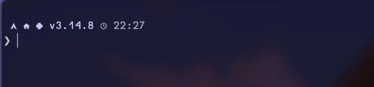

# kitty-smooth-cursor

A patch for the [kitty](https://github.com/kovidgoyal/kitty) terminal that makes
the cursor glide to its new position instead of jumping there. The cursor
stretches in the direction it travels and settles back into its normal shape
when it arrives. The motion model is ported from
[GregTheMadMonk/alacritty-smooth-cursor](https://github.com/GregTheMadMonk/alacritty-smooth-cursor).

<!-- TODO: record a demo, save it as assets/demo.gif and uncomment the line below

-->
_Demo GIF coming soon._

## How it differs from kitty's `cursor_trail`

kitty already ships a cursor animation, [`cursor_trail`](https://sw.kovidgoyal.net/kitty/conf/#opt-kitty.cursor_trail).
The two work differently:

|                    | `cursor_trail` (built in) | `cursor_smooth_motion` (this patch) |
|--------------------|---------------------------|-------------------------------------|
| What moves         | A trail drawn behind the cursor. The cursor itself has already jumped to its new position. | The cursor itself. kitty's own cursor is hidden until the animation settles. |
| Shape              | A quad whose four corners move independently, so it can skew. | An axis-aligned rectangle whose four edges move independently, so it can only stretch. |
| Short moves        | Skipped below `cursor_trail_start_threshold` (2 cells by default). | Every move is animated, including single cells. |
| Rapid moves        | Waits until the cursor has rested for `cursor_trail` ms. | Follows the cursor at most once every `cursor_smooth_motion_antijitter` ms. |
| Shape changes      | Not animated. | Block, beam and underline morph into each other. |
| Text under it      | Covered by the trail color. | Stays readable: the moving cursor samples the rendered frame and picks a contrasting color for the text below it. |
| Hiding the cursor  | The trail fades out. | The cursor fades out and back in. |

You can enable both, but you probably want only one of them.

## How the motion works

Every 1/60th of a second, each edge of the cursor covers a fixed fraction of
its remaining distance to the real cursor (exponential ease-out):

```
edge = edge + (target - edge) * f
```

- The edges on the side the cursor is moving towards use
  `f = cursor_smooth_motion_factor`.
- The trailing edges use `f = cursor_smooth_motion_factor * cursor_smooth_motion_spring`.
  Since they are slower, the cursor stretches while it moves.
- The stretch is capped at `cursor_smooth_motion_max_stretch` times the final
  size by holding back the leading edges. On a long jump the cursor therefore
  travels as a capped bar at the speed of its trailing edges.
- `f` is converted to the actual frame time (`1 - (1 - f)^(60 * dt)`), so the
  speed does not depend on the frame rate.
- When every edge is within half a pixel of its target, the animation stops
  and kitty draws its normal cursor again. An idle cursor costs nothing.

There is no fixed duration and no special handling of line jumps versus
single-cell moves; the difference comes from the distance alone. With the
defaults, a single-cell move settles in about 0.3 s and a jump across the
screen in about 0.7 s.

## Building

You need the usual [kitty build dependencies](https://sw.kovidgoyal.net/kitty/build/),
plus:

- `git`, Go and Python 3
- `slangc` from [shader-slang](https://github.com/shader-slang/slang). kitty
  0.49 and later compile their shaders with it.
- The Symbols Nerd Font Mono font, which the kitty build bundles

On Arch Linux, installing the `kitty` package pulls in the runtime libraries.
The rest is:

```sh
sudo pacman -Syu --needed base-devel git go python shader-slang ttf-nerd-fonts-symbols-mono
```

Then, from a clone of this repository:

```sh
./rebuild-kitty-smooth.sh            # newest kitty release
./rebuild-kitty-smooth.sh v0.49.2    # or a specific tag, branch or commit
```

The script does the following:

1. Clones kitty into `./kitty`.
2. Checks out the requested version and applies the patch.
3. Builds kitty and installs it to `$HOME/.local/kitty-smooth`. Set `PREFIX` to
   install somewhere else.

A kitty installed by your package manager is not touched. The HTML docs and
man pages are skipped, since building them needs Sphinx.

If `slangc` is not packaged for your distribution, unpack a
[slang release](https://github.com/shader-slang/slang/releases) into
`./toolchain/slang`. The script picks up `./toolchain/slang/bin/slangc`
automatically.

### Building by hand

```sh
git clone https://github.com/kovidgoyal/kitty.git
cd kitty
git checkout v0.49.2
git apply --3way ../kitty-smooth-cursor.patch
python3 setup.py build            # development build, run with ./kitty/launcher/kitty
```

## Usage

```sh
~/.local/kitty-smooth/bin/kitty -o cursor_smooth_motion=yes
```

To enable it permanently, add `cursor_smooth_motion yes` to `kitty.conf`. An
unpatched kitty reading the same config only logs
`Ignoring unknown config key`, so one `kitty.conf` can serve both. If you use
`cursor_trail`, turn it off in the patched kitty (`-o cursor_trail=0`).

## Options

| Option | Default | Description |
|--------|---------|-------------|
| `cursor_smooth_motion` | `no` | Animate the cursor moving to its new position. |
| `cursor_smooth_motion_factor` | `0.2` | Fraction of the remaining distance the leading edges cover every 1/60th of a second, between 0 and 1. `1` moves the cursor instantly. |
| `cursor_smooth_motion_spring` | `0.8` | Multiplier for the factor of the trailing edges, between 0 and 1. Smaller values stretch the cursor more; `1` moves it without changing its shape. |
| `cursor_smooth_motion_max_stretch` | `3 2` | Maximum width and height of the cursor while moving, as multiples of its final size. A single value applies to both. Values below `1` are treated as `1`. |
| `cursor_smooth_motion_antijitter` | `50` | Minimum time in milliseconds between changes of the position the cursor moves towards. Keeps the cursor from chasing programs that move it around rapidly while redrawing. `0` always follows immediately. |

If you used alacritty-smooth-cursor, its settings map like this:

| alacritty-smooth-cursor | this patch |
|-------------------------|------------|
| `smooth_motion` | `cursor_smooth_motion` |
| `smooth_motion_factor` | `cursor_smooth_motion_factor` |
| `smooth_motion_spring` | `cursor_smooth_motion_spring` |
| `smooth_motion_max_stretch_x`, `smooth_motion_max_stretch_y` | `cursor_smooth_motion_max_stretch x y` |
| `smooth_motion_antijitter_ms` | `cursor_smooth_motion_antijitter` |
| `block_replace_shape` | not ported, kitty draws the block cursor natively (see `cursor_shape`) |

## Updating after a kitty release

Run the script again:

```sh
./rebuild-kitty-smooth.sh
```

It resets `./kitty`, checks out the newest release tag and re-applies the patch
with `git apply --3way`. When upstream has changed the code around a hunk, a
plain `git apply` fails, but `--3way` can still merge it. For that it needs the
history of the version the patch was made against (v0.49.2), so keep `./kitty`
a full clone, not a shallow one.

If the merge conflicts in one of the generated files
`kitty/options/{parse.py,types.py,to-c-generated.h}`:

1. Resolve the conflict either way and build.
2. Inside `./kitty`, regenerate the files with
   `./kitty/launcher/kitty +launch gen/config.py`.
3. Build again.

## Known limitations

- Developed and tested against kitty 0.49.2 on Arch Linux. As of October 2026
  the patch also applies to kitty's master branch with `--3way` and builds
  there. Only Linux builds have been tried; macOS is untested.
- With the default antijitter, the cursor can start moving up to 50 ms late
  after rapid cursor movement.
- Like in alacritty-smooth-cursor, a cursor that is hidden and shown again fades
  at a third of the motion speed, which takes about a second.
- When the focus moves to another split window or tab, the cursor glides over
  from its previous position, like kitty's `cursor_trail` does.
- The moving cursor is drawn on top of the finished frame. With kitty's
  `custom_shaders`, the colors under it are read from the frame before the
  custom effect is applied.
- While moving, text under the cursor is colored with alacritty-smooth-cursor's
  contrast formula, which can differ from `cursor_text_color`. Once the cursor
  settles, kitty's own cursor takes over.
- Hollow cursors animate as one outlined rectangle.
- This is an unofficial patch and not part of kitty. Please don't report
  problems with patched builds to the kitty project.

## Credits

- The motion model, its defaults and the text contrast formula come from
  [alacritty-smooth-cursor](https://github.com/GregTheMadMonk/alacritty-smooth-cursor)
  by GregTheMadMonk, a fork of [Alacritty](https://github.com/alacritty/alacritty)
  (Apache-2.0). This patch reimplements them for kitty.
- [kitty](https://github.com/kovidgoyal/kitty) is by Kovid Goyal.

## License

GPL-3.0, the same as kitty. See [LICENSE](LICENSE).
